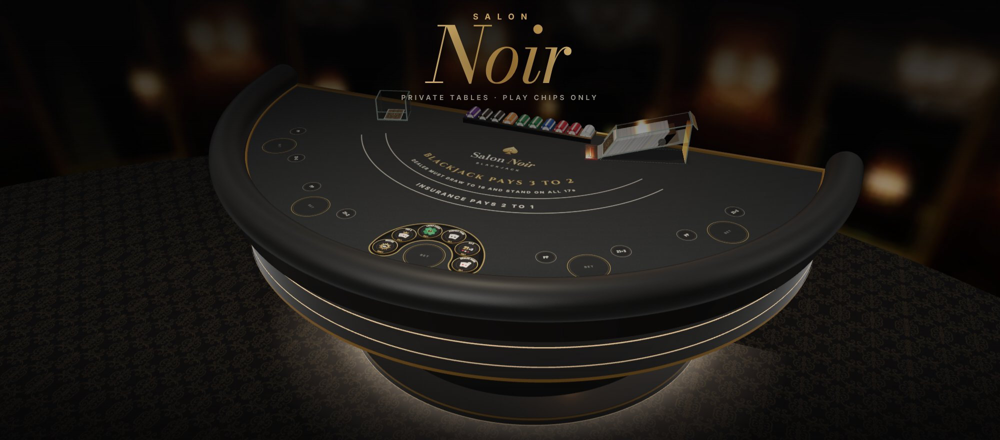
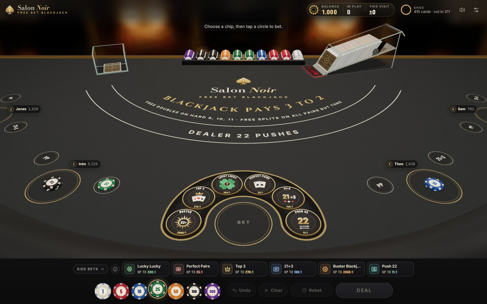
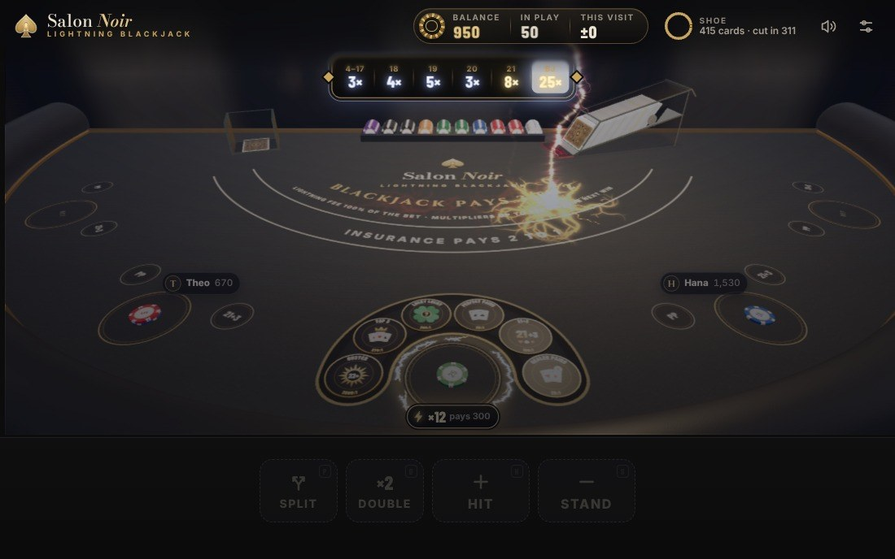
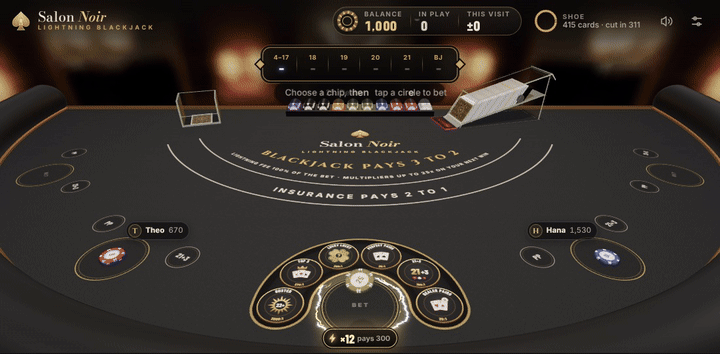
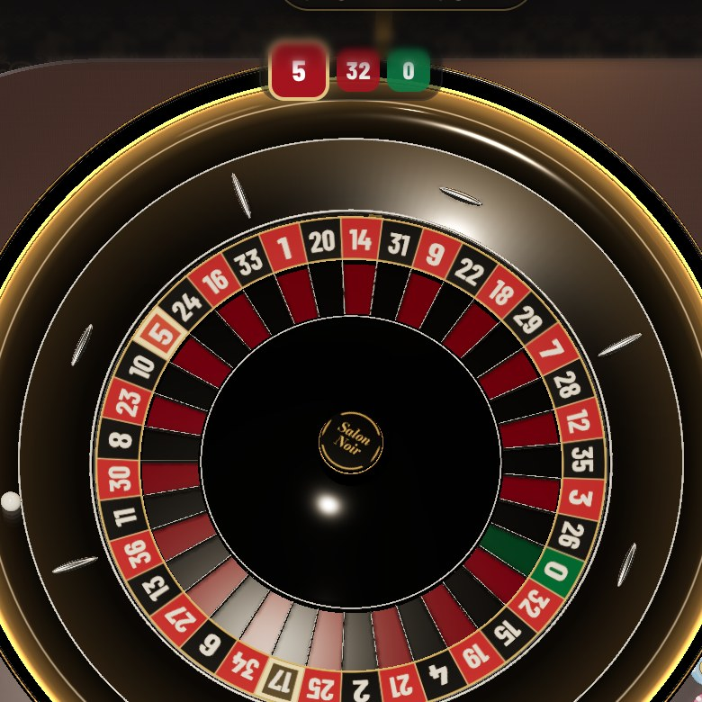
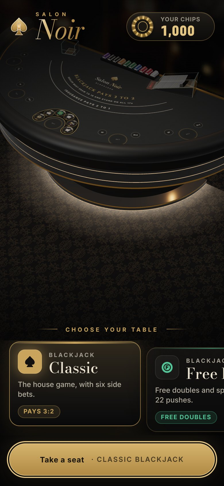
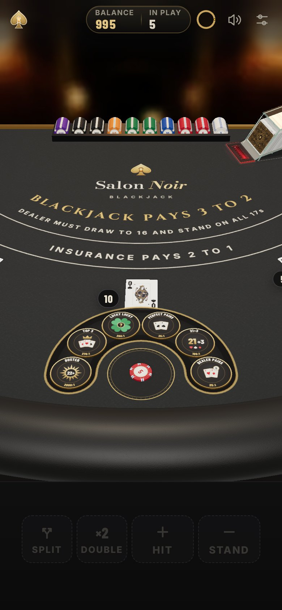
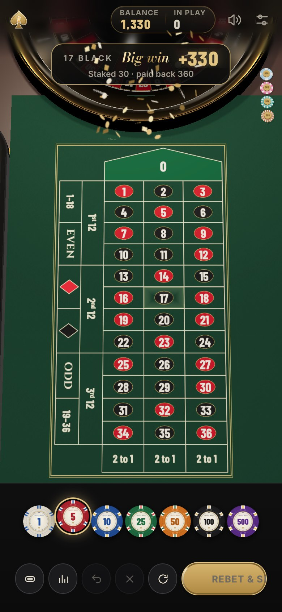

<div align="center">


# Salon Noir

**A private casino in the browser.**<br>
First-person 3D blackjack and European roulette, dealt at real pace by croupiers with voices of their own.<br>
Made for a few friends around one screen. Play chips only.




**[The tables](#the-tables)** &nbsp;·&nbsp; **[Inside the salon](#inside-the-salon)** &nbsp;·&nbsp; **[On your phone](#on-your-phone)** &nbsp;·&nbsp; **[Run it](#run-it)** &nbsp;·&nbsp; **[Keys](#keys)**

</div>

<br>

## The tables

One chip balance follows you from table to table, and a hand you walk away from is never lost: a reload, a closed tab or a phone that drops the page, and the hand is played out and paid on your next visit.

<table>
<tr>
<td width="50%" valign="top">

<h3>♠&nbsp; Classic Blackjack</h3>
Eight decks, blackjack pays 3:2, the dealer stands on soft 17. Even money on your blackjack against an ace, a ten-card Charlie, and six side bets: Lucky Lucky, Perfect Pairs, Top 3, 21+3, Buster Blackjack and Dealer Pairs.
</td>
<td width="50%" valign="top">

<h3>ⓕ&nbsp; Free Bet Blackjack</h3>
Free doubles on a hard 9, 10 or 11 and free splits on every pair but tens, resplit up to four hands. The catch: when the dealer ends on 22, everything still in play pushes. Push 22 takes the Dealer Pairs spot and pays 11:1 when it does.
</td>
</tr>
<tr>
<td width="50%" valign="top">

<h3>⚡&nbsp; Lightning Blackjack</h3>
Pay a fee equal to your bet and lightning strikes a multiplier onto every final total, up to 25× on a blackjack. Win, and the multiplier on your total rides on your next hand; win that one too and your fee comes back multiplied.
</td>
<td width="50%" valign="top">

<h3>◎&nbsp; European Roulette</h3>
Single zero with la partage, the full racetrack with neighbours and the call bets (Voisins, Tiers, Orphelins, Jeu zéro). Bets stay open while the ball runs, until the croupier calls "No more bets".
</td>
</tr>
</table>

<p align="center"><sub>🔒&nbsp; <b>Lightning Roulette</b> and <b>Mega Lightning</b> are being built: in the lobby now as "Opening soon".</sub></p>

## Inside the salon

<table>
<tr>
<td width="56%"></td>
<td valign="middle">
<h3>When lightning strikes</h3>
The room goes dark and a hum climbs, static crawls over the brass, and the strikes come quicker and quicker, the biggest held back a breath before it lands with the full peal.<br><br>
When a multiplier you carried pays, a gold bolt drives into your stack, the picture holds for a beat, the dealer calls <i>"Lightning strikes!"</i> and the bonus counts up as it is paid. Outside, a storm comes nearer the bigger the multiplier riding on your bet.
</td>
</tr>
<tr>
<td valign="middle">
<h3>A wheel that plays fair</h3>
The ball is simulated, not animated (after Small and Tse's study of the roulette wheel), and the croupier spins with bets still open, just as at a real table.<br><br>
From the call, the numbers you cover light up on the wheel. The croupier rakes in the losing chips, cuts the winnings in stacks of twenty and pushes each player's chips home; a straight-up win gets a low camera over the cloth and a slow-motion replay behind the ball.
</td>
<td width="44%"></td>
</tr>
</table>

<table>
<tr>
<td width="33%" valign="top"><b>Dealers who talk</b><br>James, Marco, Elena and Sofia each deal at their own pace and call the game aloud, in two British voices.</td>
<td width="33%" valign="top"><b>Company at the table</b><br>Up to four other players, with their own bankrolls and styles, from basic strategy to gut feel.</td>
<td width="33%" valign="top"><b>A shoe you can see into</b><br>Clear acrylic after real eight-deck shoes, its card reader lighting red as each card goes over it.</td>
</tr>
<tr>
<td valign="top"><b>Sound you can place</b><br>Cards and chips heard left or right where they land, music that ducks under the calls, a room that murmurs.</td>
<td valign="top"><b>Last hands</b><br>Every round at every table, with its cards, side bets and net, and this visit's running total.</td>
<td valign="top"><b>Rules from real filings</b><br>Blackjack and side bets after Nevada and New Jersey, roulette after New Jersey, Singapore and Monte-Carlo.</td>
</tr>
</table>

## On your phone

<p align="center">
&nbsp;
&nbsp;

</p>

Made for an iPhone held upright as much as for a desktop: the camera fits itself to the screen, the phone taps back as you play, and graphics presets (Sharp, Balanced, Battery saver), Reduce motion and Flashing effects (Full, Soft, Off) keep it smooth and comfortable.

To play anywhere, with no computer running, publish it with **GitHub Pages** (free for a public repository):

1. On GitHub, open the repository's **Settings → Pages**.
2. Under **Build and deployment**, set **Source** to **Deploy from a branch**, pick **main** and **/ (root)**, and save.
3. A minute later the game is at **https://onealper.github.io/salon-noir/**, and every push to `main` publishes again.

Open that address in Safari and tap **Share → Add to Home Screen**: Salon Noir opens full screen from its own icon and, after one visit, plays offline. On Android, Chrome offers **Install app**.

> [!NOTE]
> Anyone with the address can open a Pages site. It's play chips only, with nothing to sign in to. Chips live in the browser that plays them, and on an iPhone the home-screen app keeps a balance of its own, apart from Safari's.

## Run it

No install and no build: serve the folder and open it in a browser.

```bash
git clone https://github.com/onealper/salon-noir.git
cd salon-noir
python3 -m http.server 8000
```

Then go to **http://localhost:8000**. (Opening `index.html` straight from the disk won't work: browsers block ES modules on `file://`.) A phone on the same Wi-Fi can play too, at `http://<your-computer's-IP>:8000`.

**To update**, run `git pull` in the folder and reload the page with <kbd>Cmd</kbd>+<kbd>Shift</kbd>+<kbd>R</kbd> (<kbd>Ctrl</kbd>+<kbd>Shift</kbd>+<kbd>R</kbd> on Windows).

> [!TIP]
> Still seeing an old version? Check that you're serving the folder you updated (`git log --oneline -1` there shows the latest commit), and that no older server is still holding port 8000: a second `http.server` on the same port stops with "Address already in use". Adding `?nosw` to the address also clears the offline copy from that browser.

## Keys

<details>
<summary><b>Keyboard shortcuts</b> for every table, blackjack, roulette and the lobby</summary>
<br>

**At every table**

| Key | Action |
|---|---|
| <kbd>1</kbd> – <kbd>7</kbd> | Pick a chip (1 to 500) |
| <kbd>U</kbd> or <kbd>Backspace</kbd> · <kbd>C</kbd> · <kbd>R</kbd> · <kbd>X</kbd> | Undo · clear · rebet · double the bets |
| <kbd>Space</kbd> or <kbd>Enter</kbd> | Deal or spin (on an empty layout: rebet, then deal or spin) |

**At blackjack**

| Key | Action |
|---|---|
| <kbd>H</kbd> · <kbd>S</kbd> · <kbd>D</kbd> · <kbd>P</kbd> | Hit · stand · double · split |
| <kbd>Y</kbd> · <kbd>N</kbd> | Insurance (or even money): yes · no |
| <kbd>Space</kbd> or <kbd>Enter</kbd> | Next hand, once the result is up |

**At roulette**

| Key | Action |
|---|---|
| <kbd>T</kbd> | The racetrack: arrow keys and <kbd>Home</kbd> move round it, <kbd>Enter</kbd> or <kbd>Space</kbd> bets on a number and its neighbours, or a call bet |
| <kbd>S</kbd> | Statistics (at blackjack, <kbd>S</kbd> is Stand) |
| <kbd>Esc</kbd> | Closes the racetrack or the statistics |
| <kbd>Space</kbd> or <kbd>Enter</kbd> | While the ball runs: hurry it (hold to keep hurrying) |

**In the lobby**, <kbd>←</kbd> <kbd>→</kbd> move along the tables and <kbd>Enter</kbd> or <kbd>Space</kbd> takes the seat. <kbd>Esc</kbd> closes Settings, and a button you reach with <kbd>Tab</kbd> takes <kbd>Space</kbd> and <kbd>Enter</kbd> as its own press.

</details>

## Under the hood

Plain HTML and ES modules: **no build step, no npm, no framework**. The game asks nothing of any other server: every library, font, sound and texture is in the repository.

| Layer | Built with |
|---|---|
| **3D** | [three.js](https://threejs.org), scenes in centimetres; clear acrylic drawn with its own Fresnel and refraction shaders |
| **Sound** | Web Audio, five buses (table, dealer, room, music, interface); the hum, ticks and ball roll are synthesised |
| **Motion** | anime.js, Torph, canvas-confetti, web-haptics and cuelume |
| **Offline** | A service worker (`sw.js`) and `manifest.webmanifest` make it a home-screen app |
| **Tests** | `node --test` from the repo root (Node 22+, nothing to install): every payout, the house edges, money conservation, saved hands played out, the ball landing where it was drawn |

<details>
<summary><b>Project layout</b></summary>
<br>

```
index.html        Page shell
sw.js             Offline play; manifest.webmanifest and icons/ make the home-screen app
src/              All code, styles, fonts, sounds and vendored libraries
  app.mjs         The salon: settings, sound, lobby, moving between rooms (start reading here)
  engine.mjs      Blackjack rules engine; sidebets.mjs and players.mjs beside it
  blackjack/      The blackjack room: controller, the Lightning board and its storm, hand history
  core/           Lobby, wallet, hand history, table modes, brand, haptics, chips and bet controls
  scene/          The shared 3D stage, the blackjack table, the glass, the lightning
  roulette/       The roulette room: rules, physics, replay camera, wheel and table
test/             node --test suite over the rules and money code
assets/           Card art, cloth, wood and leather, the salons round each table
docs/             The logo and these screenshots
```

</details>

To work on it, start with **[PROJECT.md](PROJECT.md)**: the full brief (architecture, file map, design rules and what's next), written so any developer or AI assistant can pick up the work.

## Credits

Built on open-source libraries and openly licensed sounds and fonts; the dealers' voices, the roulette croupier's sounds and the roulette music were made with ElevenLabs. **[CREDITS.md](CREDITS.md)** lists every library, font, sound and image, [src/sounds/CREDITS.txt](src/sounds/CREDITS.txt) each sound file, and [src/vendor/README.md](src/vendor/README.md) the library versions and local changes.

## Licence

The game's own code and material are © 2026 onealper, all rights reserved: see **[LICENSE](LICENSE)**. Third-party code, fonts, sounds and images keep their own licences (listed in CREDITS.md, with the licence files beside them), and sounds made from CC BY-SA material stay CC BY-SA.

<br>

<div align="center">
<br>
<sub>A private project. Play chips only, no real money.</sub>
</div>
