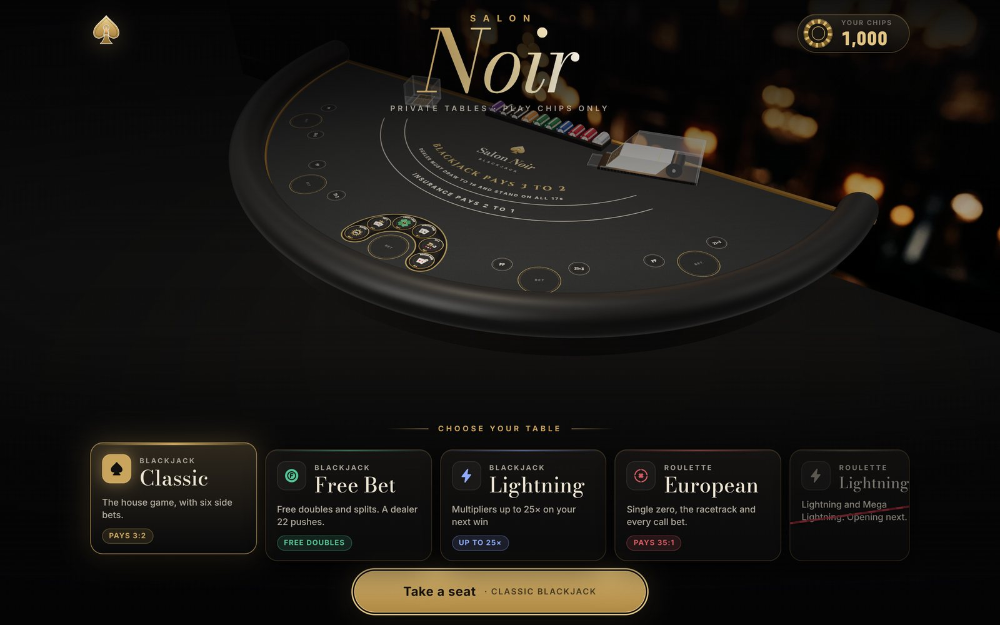
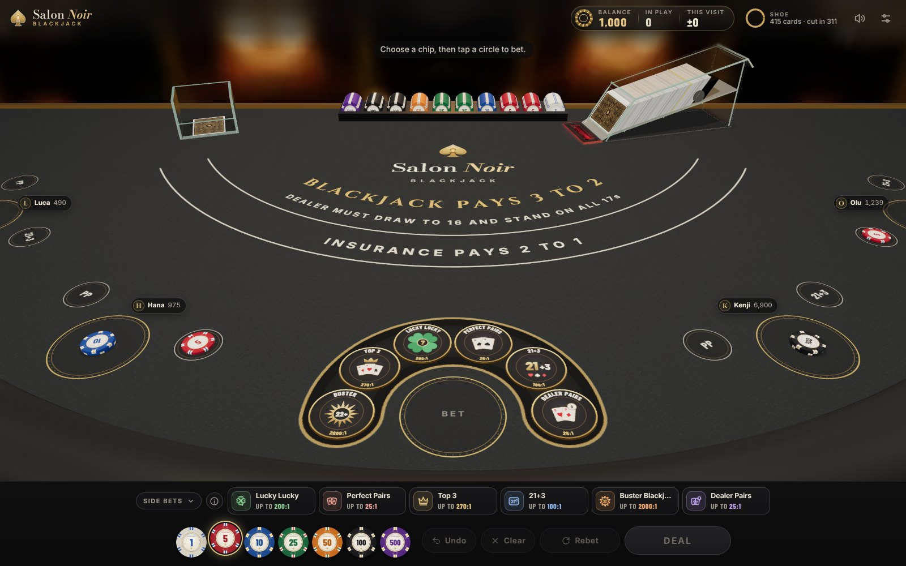
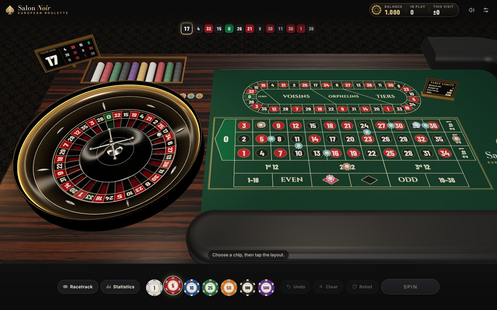

<div align="center">

# Salon Noir

**A private casino in the browser.** First-person 3D blackjack and European roulette, built for a few friends around one screen.




</div>

## Tables

| | Table | What makes it different |
|---|---|---|
| ♠ | **Classic Blackjack** | Eight decks, blackjack pays 3:2, even money on your blackjack against an ace, six side bets (Lucky Lucky, Perfect Pairs, Top 3, 21+3, Buster, Dealer Pairs) |
| ⓕ | **Free Bet Blackjack** | Free doubles on hard 9–11, free splits on every pair but tens (resplit up to four hands), dealer 22 pushes |
| ⚡ | **Lightning Blackjack** | Lightning strikes multipliers onto final totals, up to 25× on your next win |
| ◎ | **European Roulette** | Single zero with la partage, full racetrack with Voisins, Tiers, Orphelins and neighbours, physically simulated ball |
| 🔒 | **Lightning Roulette** | Coming soon |

One chip balance follows you from table to table. A hand you leave unfinished (a reload, a closed tab, a phone that drops the page) is played out for you on the next visit, standing, and paid, so leaving never undoes a hand or loses one.

<table>
<tr>
<td width="50%"></td>
<td width="50%"></td>
</tr>
</table>

## Highlights

- **Real 3D table** in three.js, seen from your seat, with the camera fitted to your screen (desktop or upright phone)
- **Dealers with personalities.** James, Marco, Elena and Sofia each deal at their own pace and speak their calls (Marco with James's voice, Elena with Sofia's)
- **AI players** at the table with their own bankrolls and styles, from basic strategy to gut feel
- **Roulette ball physics** based on published research, simulated rather than animated
- **Casino-grade sound:** spatial card and chip sounds, ducking music, a room you can hear
- **Phone-first touches:** haptics, graphics presets, battery saver, reduced motion, and a Flashing effects setting (Full, Soft, Off) for the Lightning table
- **Last hands:** every round at every table, with its cards, side bets and net, and this visit's running total
- **Rules from real filings:** blackjack and side bets after Nevada and New Jersey, roulette after New Jersey, Singapore and Monte-Carlo

## Run it

No install, no build. Serve the folder and open it in a browser:

```bash
git clone https://github.com/onealper/salon-noir.git
cd salon-noir
python3 -m http.server 8000
```

Then go to **http://localhost:8000**. (Opening `index.html` directly won't work, because browsers block ES modules on `file://`.)

To play on a phone, connect it to the same Wi-Fi and open `http://<your-computer's-IP>:8000`.

### Play on your phone over HTTPS (GitHub Pages)

The Wi-Fi address above is plain `http://`, so the phone gets the game but not what needs a secure page: playing offline, without your computer running, and a proper home-screen app. GitHub Pages serves this folder over HTTPS as it is, with no build step (the empty `.nojekyll` file tells it not to run its Jekyll site builder over the files):

1. On GitHub, open the repository's **Settings → Pages**.
2. Under **Build and deployment**, set **Source** to **Deploy from a branch**, pick **main** and **/ (root)**, and save.
3. A minute later the game is at **https://onealper.github.io/salon-noir/**. Every push to `main` publishes again.

On the iPhone, open that address in Safari and tap **Share → Add to Home Screen**. Salon Noir then opens full screen from its own icon, and after one visit it also plays offline: a service worker (`sw.js`) keeps the game on the phone. On Android, Chrome offers **Install app**. The app is described by `manifest.webmanifest`, with icons in `icons/`.

Good to know:

- Anyone with the address can open a Pages site, even when the repository is private (Pages for a private repository also needs a paid GitHub plan). It's play chips only, with nothing to sign in to.
- Chips live in the browser that plays. On iPhone the home-screen app keeps its own storage, so it starts with its own balance, apart from Safari's.
- Code and pages update on the next reload. If you replace a sound, image or font under the same file name, raise `VERSION` at the top of `sw.js`, or phones that installed the game keep the old file. The service worker also runs on `localhost`; add `?nosw` to the address to play without it (this also removes it from that browser).

### Keys

At every table:

| Key | Action |
|---|---|
| `1`–`7` | Pick a chip (1 to 500) |
| `U` or `Backspace`, `C`, `R`, `X` | Undo, clear, rebet, double the bets |
| `Space` or `Enter` | Deal or spin (rebet and deal or spin on an empty layout) |

At blackjack:

| Key | Action |
|---|---|
| `H` `S` `D` `P` | Hit, stand, double, split |
| `Y` `N` | Insurance (or even money) yes / no |
| `Space` or `Enter` | Next hand, once the result is up |

At roulette:

| Key | Action |
|---|---|
| `T` | The racetrack: arrow keys and `Home` move round it, `Enter` or `Space` bets on a number and its neighbours or a call bet |
| `S` | Statistics (at blackjack `S` is Stand) |
| `Esc` | Closes the racetrack or statistics |
| `Space` or `Enter` | While the ball runs, hurries it (hold to keep hurrying) |

In the lobby, `←` `→` move along the tables and `Enter` or `Space` takes the seat. `Esc` closes Settings. A button you reach with `Tab` takes `Space` and `Enter` as its own press.

## Project layout

```
index.html        Page shell
sw.js             Offline play (service worker); manifest.webmanifest and icons/ make the home-screen app
src/              All code, styles, fonts, sounds and vendored libraries
  app.mjs         The salon: settings, sound, lobby, moving between rooms (start reading here)
  engine.mjs      Blackjack rules engine; sidebets.mjs and players.mjs beside it
  blackjack/      The blackjack room: controller, Lightning board, hand history entries
  core/           Lobby, wallet, hand history, table modes, branding, haptics, shared chips and bet controls
  scene/          The shared 3D stage and the blackjack 3D scene
  roulette/       Roulette room, rules, physics and 3D
test/             node --test suite over the rules and money code
assets/           Card art and table and wood textures
docs/             Screenshots
```

## Working on it

Start with **[PROJECT.md](PROJECT.md)**. It's the full brief (architecture, file map, design rules and what's next), written so any developer or AI assistant can pick up the work. `node --test` from the repo root runs the rules and money tests (Node 22+, nothing to install).

On Node 24, use `node --no-experimental-global-navigator --test` so the wallet tests use their simulated browser environment.

Optional browser checks live in `tools/check-blackjack.cjs`, `tools/check-roulette.cjs`, and `tools/check-audio.cjs`. With Playwright and Chromium available as development tools and the game served locally, run `node tools/check-roulette.cjs` (or either other filename). `SALON_BASE_URL` selects a different server address; see [PROJECT.md](PROJECT.md#tests) for configuration and the distinction between browser checks and physical phone testing.

## Credits

Built on open-source libraries and openly licensed sounds and fonts. See **[CREDITS.md](CREDITS.md)** for every library, font, sound and image, [src/sounds/CREDITS.txt](src/sounds/CREDITS.txt) for each sound file, and [src/vendor/README.md](src/vendor/README.md) for library versions and local changes.

## Licence

The game's own code and material are © 2026 onealper, all rights reserved: see **[LICENSE](LICENSE)**. Third-party code, fonts, sounds and images keep their own licences (listed in CREDITS.md, with the licence files beside them), and sounds made from CC BY-SA material stay CC BY-SA.

---

<sub>Private project. Play chips only, no real money.</sub>
